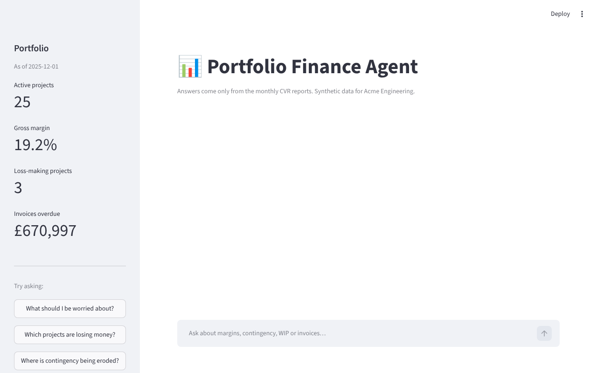
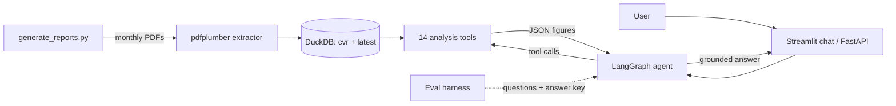

# Portfolio Finance Agent

An AI agent that reads monthly project finance reports (Cost Value Reconciliation PDFs) for an engineering consultancy and answers directors' questions in plain English, using only figures it can trace back to the reports.

> *"What should I be worried about?"* → the agent calls `risk_overview`, finds the loss-making projects, the client who isn't paying, the project billing nothing, and the two projects that have burned through their contingency, and explains each with figures from the reports.



> **All data is synthetic.** "Acme Engineering", its clients, projects and people are invented. The reports come from `data/generate_reports.py`, which deliberately plants problems so the agent's answers can be checked against a known answer key.

## Why this project

Finance teams in project-based businesses review dozens of monthly CVR reports to find the few projects that need attention. This is a clean-room, open-source version of a pattern I've built in production: an LLM agent that does that triage through **tool calling over structured data**, rather than asking the model to read PDFs and do arithmetic itself.

The design choices that matter:

- **The LLM never does the maths.** It chooses tools; SQL in DuckDB does every calculation. The model writes the explanation.
- **Grounding rules in the prompt, then measured.** Every £ amount and % in an answer must appear in a tool result. The evaluation checks this automatically.
- **Tested against a known answer key.** The data generator records which project has which planted problem, so tests prove the tools find exactly those projects, with no misses and no false alarms, across different random seeds.

## Architecture



```
├── data/generate_reports.py      synthetic CVR PDFs + ground_truth.csv
├── src/
│   ├── extraction/pdf_parser.py  PDF -> one row per project per month
│   ├── storage/db.py             DuckDB table `cvr` and view `latest`
│   ├── tools/                    margins, WIP & invoicing, risk, portfolio, projects
│   ├── agent/                    LangGraph graph + system prompt (grounding rules)
│   └── api/main.py               FastAPI: POST /ask, GET /health
├── app/streamlit_app.py          chat UI
├── eval/                         questions.yaml + run_eval.py -> results.md
└── tests/                        59 tests (extractor, tools, agent wiring, eval checks)
```

## The tools

| Area | Tools |
|---|---|
| Portfolio | `portfolio_summary`, `portfolio_trend` |
| Margin | `lowest_margin_projects`, `highest_margin_projects`, `declining_margin_projects` |
| Cash | `overdue_invoice_projects`, `overdue_wip_projects`, `unbilled_revenue_projects` |
| Risk | `contingency_erosion_projects`, `admin_cost_outliers`, `risk_overview` |
| Single project | `search_projects`, `project_details`, `project_history` |

Each tool is a plain Python function with a docstring. The docstring is what the LLM reads to decide when to use it.

## Run it

```bash
python -m venv .venv
source .venv/bin/activate            # Windows: .venv\Scripts\activate
pip install -r requirements.txt

python data/generate_reports.py      # 12 monthly PDFs, 25 projects
python -m src.storage.db             # extract into DuckDB
python -m pytest                     # 59 tests, no API key needed

cp .env.example .env                 # add an OpenAI, Groq or Azure OpenAI key
streamlit run app/streamlit_app.py   # chat UI
uvicorn src.api.main:app --reload    # API, docs at http://localhost:8000/docs
python -m src.agent.graph "Which projects are losing money?"
```

## Planted problems

| Scenario | What happens | Tool that should find it |
|---|---|---|
| `margin_collapse` | Margin falls ~6 points a month until the project is loss-making | `declining_margin_projects`, `lowest_margin_projects` |
| `overdue_invoices` | Most invoices go unpaid | `overdue_invoice_projects` |
| `contingency_erosion` | 25–40% of remaining contingency used each month | `contingency_erosion_projects` |
| `wip_no_invoicing` | Revenue recognised, nothing invoiced | `overdue_wip_projects`, `unbilled_revenue_projects` |
| `admin_overrun` | Admin cost at 12–18% of revenue instead of 2–4% | `admin_cost_outliers` |

## Evaluation

`python -m eval.run_eval` asks 12 questions (including one about a project that doesn't exist) and scores:

- **Tool choice:** did the agent call an appropriate tool?
- **Recall:** did the answer name every project with the planted problem?
- **Grounding:** does every £ and % in the answer match a tool result? This catches invented numbers, and numbers the model calculated itself.
- **Refusal:** for an unknown project, did it say so instead of making figures up?

### Results (GPT-OSS 120B via Groq)

| Metric | Score |
|---|---|
| Tool choice accuracy | 100% |
| Project recall (planted problems found) | 100% |
| Answers with no invented numbers | 100% |
| Correctly refused unknown project | 1/1 |

Full per-question results: [`eval/results.md`](eval/results.md). LLM output varies between runs, so re-run to see the spread.

### How evaluation improved the agent

| Run | Grounded answers | Recall | Refusal | What the failures showed | Fix |
|---|---|---|---|---|---|
| 1 | 75% | 89% | 0/1 | Model **added up** invoice totals and **subtracted** contingency values itself. Also checker false alarms ("£20.8 m", non-breaking spaces, "unable to locate"). | Tools now return totals and first-to-last changes; prompt rule "never calculate". Checker fixed, with tests. |
| 2 | 92% | 100% | 1/1 | Margin of 19.2% described as "just under 20%": not invented, but misleading. | Prompt rule: quote figures exactly, never approximate. |
| 3 | 83% | 100% | 1/1 | Model **divided** figures to get ratios ("0.7% of invoiced"). | `project_details` now returns the ratios too. |
| 4 | **100%** | **100%** | **1/1** | | |

The lesson: when the model does arithmetic, don't just tell it to stop. Move the calculation into the tool, so the model only has to read figures out.

`python -m eval.run_eval --fake` runs the same harness with a keyword-routing baseline and no API key; that's what CI runs.

## What I'd do next

- Run the evaluation several times per change and report the average, since LLM output varies
- Langfuse tracing on every run, to see tool choices and latency per question
- Red-team questions: prompt injection inside the PDFs, requests for data the user shouldn't see
- Read real-world PDFs with messier layouts (scanned pages, merged cells) using an LLM extraction fallback
- Elasticsearch for free-text commentary in the reports, alongside the structured figures
